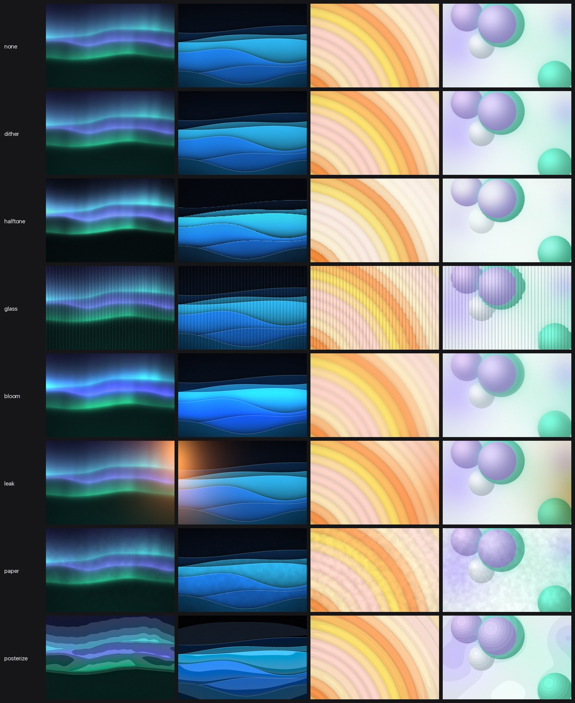
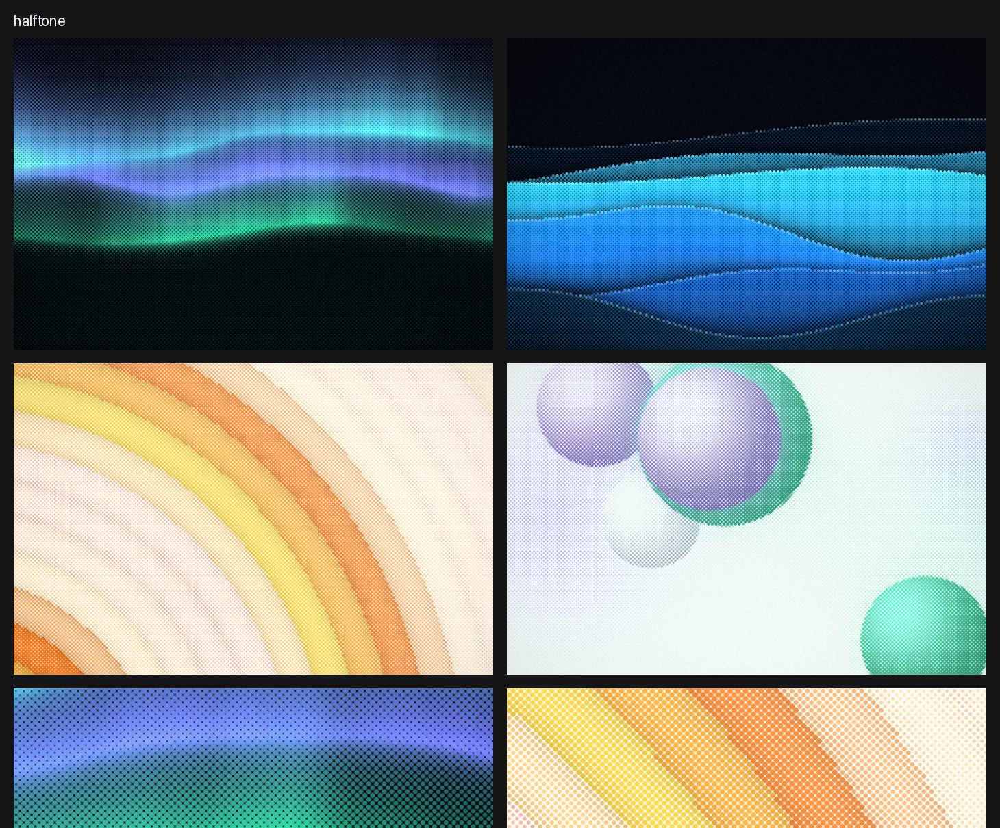
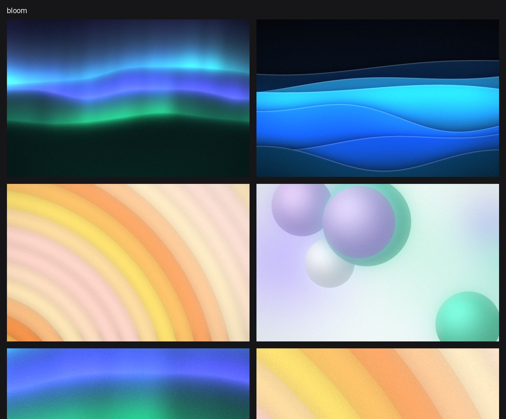
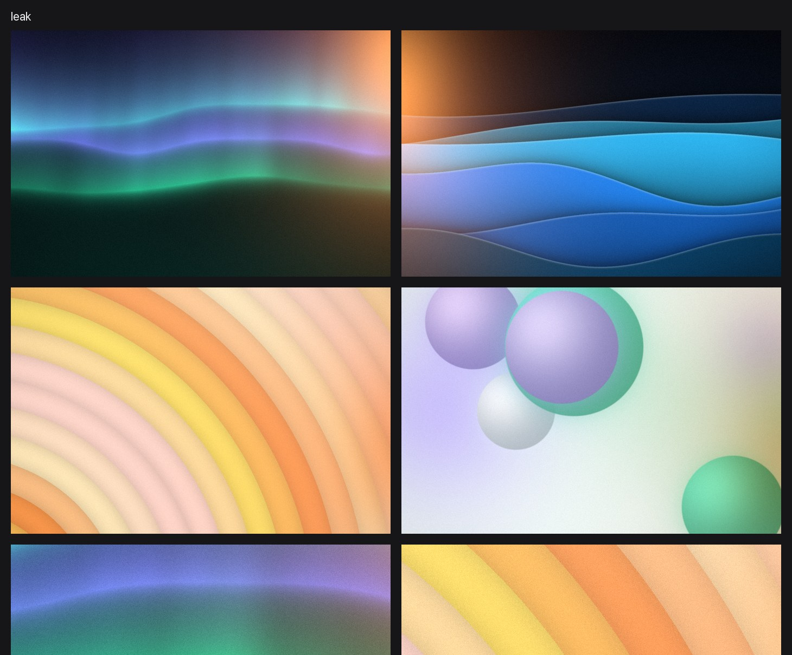
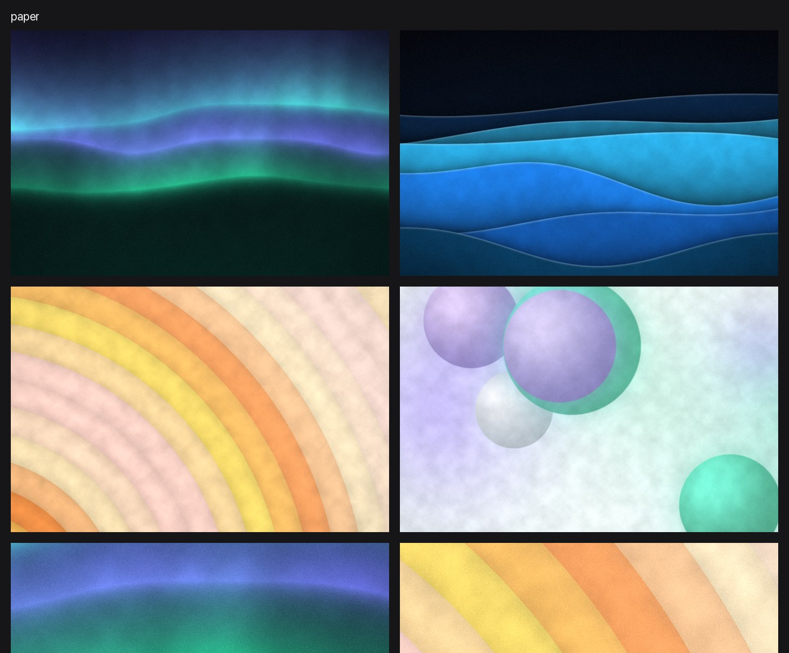
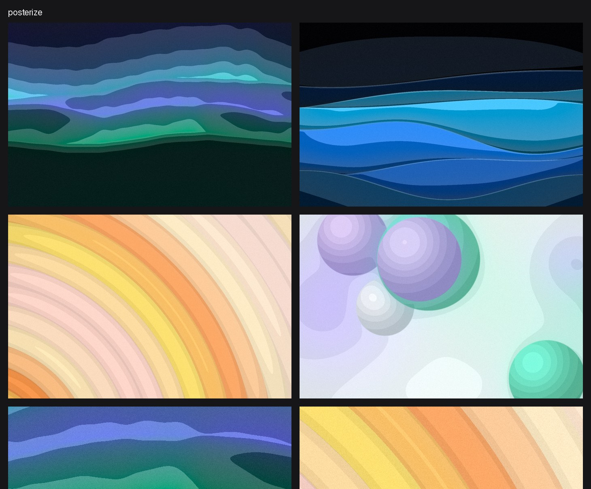

# Effect previews

Seven effects on four pictures: aurora (dark), waves (dark), rings (light), orbs (light). Each sheet below the
overview ends with 1:1 crops. Drawn with `undertone render --effect …` from the `feature/effects` branch.

## Dither

## Halftone

## Glass

## Bloom

## Light leak

## Paper

## Posterize

