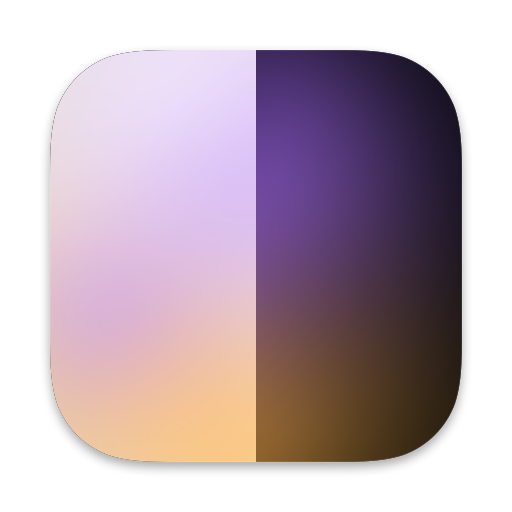
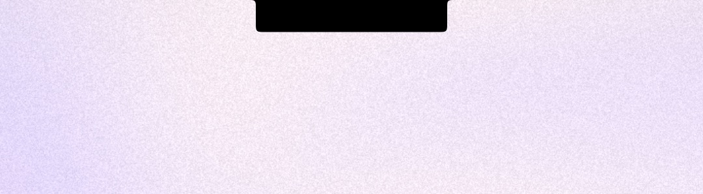
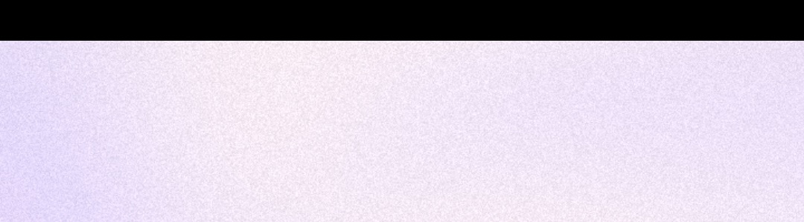
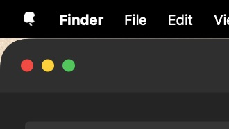
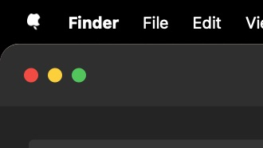
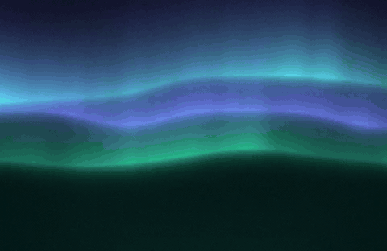

<p align="center">
  
</p>

<h1 align="center">Undertone</h1>

<p align="center">
  <b>Generated wallpapers for your Mac</b> that follow your light or dark theme, change on a schedule,<br>
  and hide the notch and the screen's corners in black.
</p>

<p align="center">
  <a href="https://github.com/mpdreamz/undertone/releases/latest"></a>
  <a href="https://github.com/mpdreamz/undertone/actions/workflows/ci.yml"></a>
  
  
  <a href="LICENSE"></a>
</p>

<p align="center">
  <a href="https://mpdreamz.github.io/undertone/"><b>Website</b></a> ·
  <a href="https://mpdreamz.github.io/undertone/getting-started/"><b>Docs</b></a> ·
  <a href="https://github.com/mpdreamz/undertone/releases/latest/download/Undertone-arm64.zip"><b>Download</b></a>
</p>

<p align="center">
  
</p>

## Install

```sh
brew install --cask mpdreamz/tap/undertone
```

or `curl -fsSL https://raw.githubusercontent.com/mpdreamz/undertone/main/install.sh | sh`, or
[download the app](https://github.com/mpdreamz/undertone/releases/latest/download/Undertone-arm64.zip). It is signed
and notarized, needs no permissions, opens at login, and updates itself. Apple Silicon, macOS 15 or later.

## Every picture is drawn on your Mac

Eleven styles in eight tonalities, each with a light and a dark half that follows your appearance. Keep a style or a
tonality, shuffle them and leave some out, or let the season choose the colours.

<table>
  <tr>
    <td><br><sub><b>Aurora</b> · curtains of light</sub></td>
    <td><br><sub><b>Waves</b> · layered ribbons</sub></td>
    <td><br><sub><b>Rings</b> · bands round a far centre</sub></td>
    <td><br><sub><b>Silk</b> · twisting ribbons</sub></td>
  </tr>
  <tr>
    <td><br><sub><b>Orbs</b> · lit spheres</sub></td>
    <td><br><sub><b>Blobs</b> · a lava lamp</sub></td>
    <td><br><sub><b>Bauhaus</b> · quarter and half circles</sub></td>
    <td><br><sub><b>Dunes</b> · stacked hills</sub></td>
  </tr>
</table>

Plus mesh, flow and contour: [all of them, in every tonality](https://mpdreamz.github.io/undertone/pictures/styles/).

## Effects, as many as you like

A vignette and a subtle grain out of the box; dither, halftone, reeded glass, bloom, a light leak, paper and posterize
when you want them. Each has its own settings, and a shuffle can add one at random.

<table>
  <tr>
    <td><br><sub><b>Halftone</b></sub></td>
    <td><br><sub><b>Glass</b></sub></td>
    <td><br><sub><b>Posterize</b></sub></td>
    <td><br><sub><b>Light leak</b></sub></td>
  </tr>
</table>

## The notch, gone. The corners, black.

A black strip as tall as the menu bar swallows the notch. Rounded corners, curved like macOS's own windows, put black
behind every window tiled into a corner.

<table>
  <tr>
    <td><br><sub>Notch, off</sub></td>
    <td><br><sub>Notch, hidden</sub></td>
  </tr>
  <tr>
    <td><br><sub>Corners, off</sub></td>
    <td><br><sub>Corners, rounded</sub></td>
  </tr>
</table>

## It moves while you're away

Turn on lock screen motion and your picture drifts while the Mac is locked, then slows to a stop on your desktop as
you unlock.

<p align="center"></p>

## Settings you can see

Every style, tonality and effect is drawn in the settings window, over the picture you have now.

<p align="center"></p>

## Settings in your dotfiles

Everything you set lives in `~/.config/undertone/config.toml`, and edits apply on their own:

```toml
[style]
mode = "shuffle"
never = ["bauhaus"]

[tonality]
mode = "season"

[effects.halftone]
on = true
spacing = 12

[shuffle]
every = "daily"

[screen]
hide_notch = true
round_corners = true
```

`undertone config --check` lists anything it cannot use. [The whole file.](https://mpdreamz.github.io/undertone/reference/configuration/)

## From the command line

```sh
undertone shuffle                                    # a new picture now, for a hotkey
undertone render --style silk --tonality dusk \
  --effect halftone -o silk.png                      # any picture, to a file
undertone movie --style aurora -o aurora.mp4         # the same, in motion
```

## Build

```sh
mise run dev     # debug build, then open build/Undertone.app
mise run test
mise run shots   # redraw every image in docs/images
mise run docs    # build the docs and landing page as CI does, served on :4000
```

Every image in this README and on the website is drawn by Undertone itself, from fixed recipes.

## Licence

MIT.
