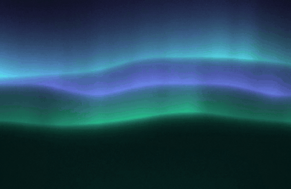
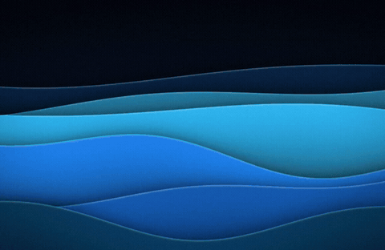
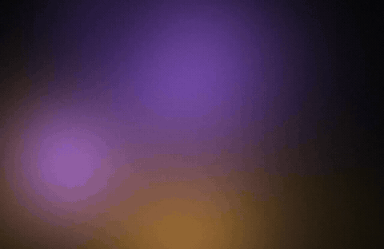
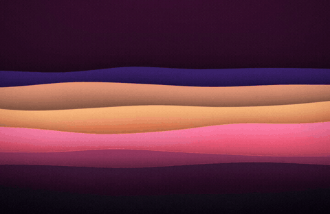
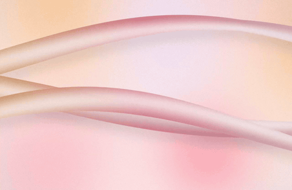
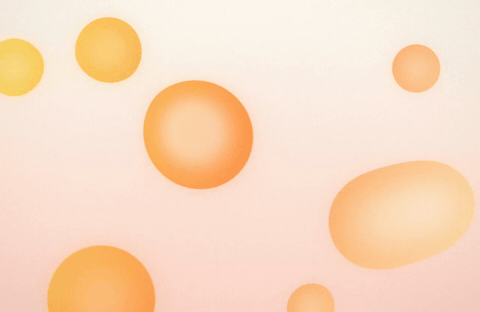
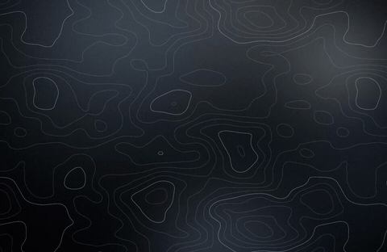
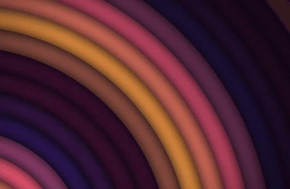

# Motion previews

Each clip is one 8-second loop of a picture drifting, then 2.5 seconds easing to a stop on the still picture (the last frame is exactly the desktop picture). Drawn with `undertone movie` from the `feature/motion` branch at 1280×832. Click an .mp4 to play it at full quality; the GIFs below are small and lossy.

## aurora

[aurora.mp4](aurora.mp4)

## waves

[waves.mp4](waves.mp4)

## mesh

[mesh.mp4](mesh.mp4)

## dunes

[dunes.mp4](dunes.mp4)

## silk

[silk.mp4](silk.mp4)

## blobs

[blobs.mp4](blobs.mp4)

## contour

[contour.mp4](contour.mp4)

## rings

[rings.mp4](rings.mp4)

