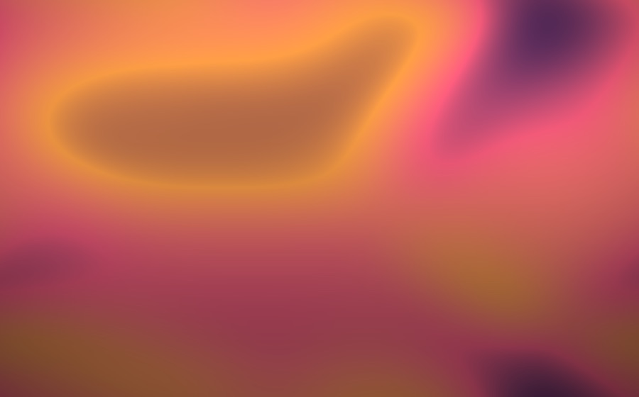
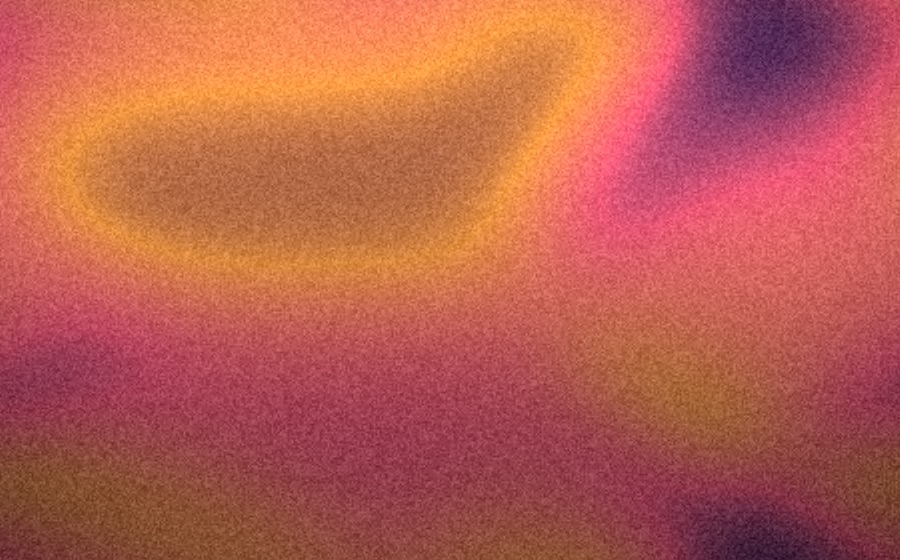
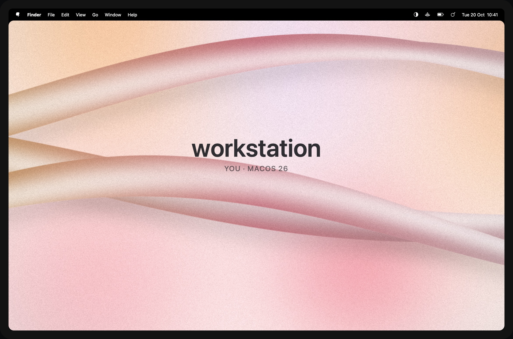

# Grain and a title

## Grain

A fine, even grain over the whole picture takes the plastic smoothness off a gradient and hides banding. **Grain** in
the menu has none, subtle (the default) and strong; **Settings…** has a slider. The grain is about a point across on
any display.

| None | Strong |
|---|---|
|  |  |

## A title

**Show Title** writes a title and a smaller subtitle in the middle of the picture, white on dark pictures and near
black on light ones. It is off until you turn it on. The text is set in **Settings…**, where these are filled in:

| Placeholder | Becomes |
|---|---|
| `{computer}` | The computer's name, as in System Settings › General › Sharing |
| `{user}` | Your full name |
| `{os}` | The macOS version, for example `26.6` |
| `{host}` | The network host name |

The defaults are `{computer}` and `{user} · macOS {os}`. Handy for telling machines apart in screen shares.

