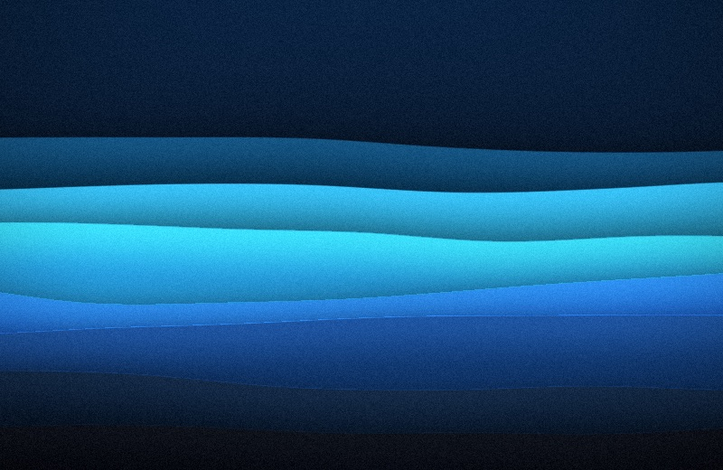
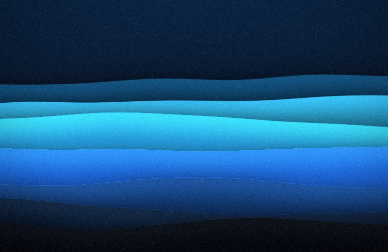
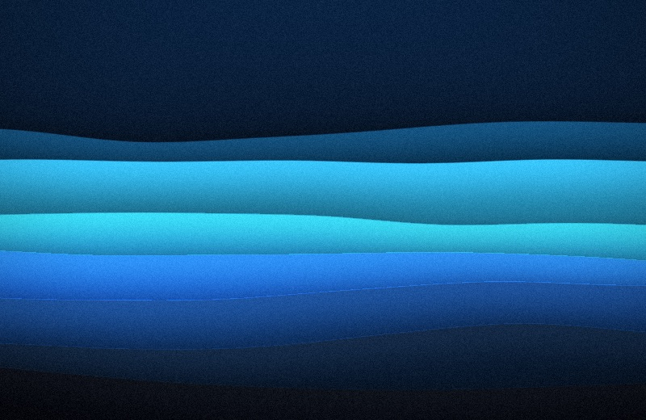

# Spaces

Out of the box every space shows the same picture. **A picture per space**, on the **Screen** page of **Settings…**,
gives each space its own instead: the same style, tonality and effects, laid out from a seed of its own.

| Space 1 | Space 2 | Space 3 |
|---|---|---|
|  |  |  |

A space keeps its picture until the next shuffle, and across restarts: the seed comes from the space's own identifier,
which macOS keeps.

macOS only lets an app set the picture of the space on screen, so Undertone sets each space's picture when you switch
to it. The first visit to a space after a shuffle shows its old picture for a moment, then the new one; after that
the space already has it.

With **Displays have separate Spaces** off (System Settings › Desktop & Dock), every display shares one space at a
time, and Undertone follows that.
