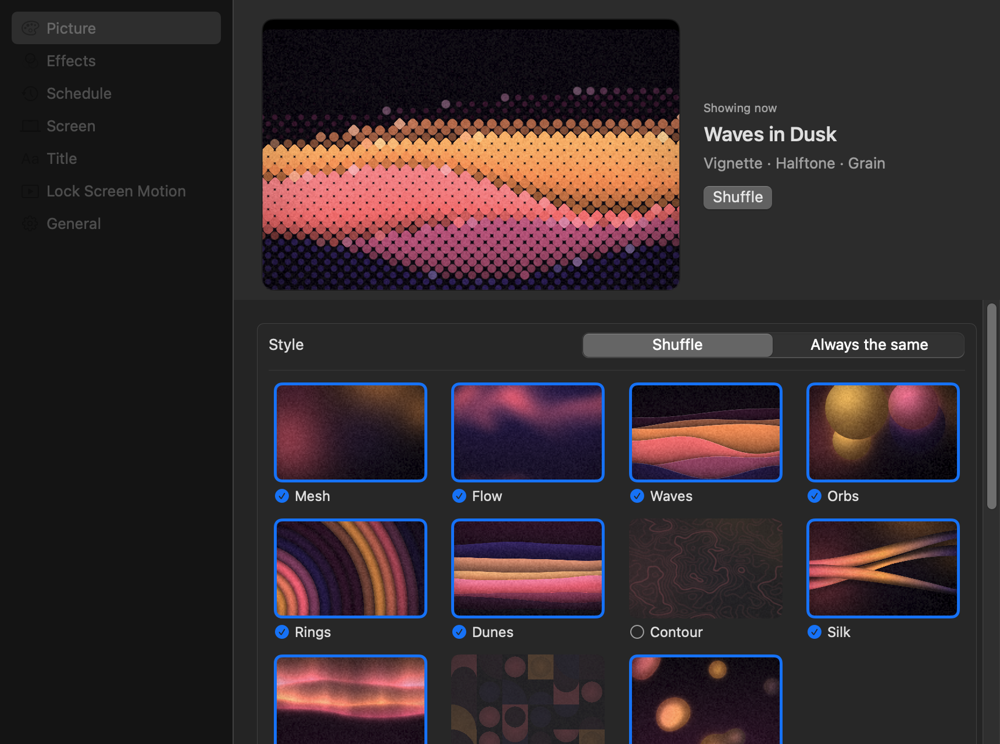

# The menu and settings

## The menu

Click the half-filled circle in the menu bar. The menu holds what you reach for often; everything else is in
**Settings…**.

| Item | What it does |
|---|---|
| The first line | What is showing now, for example *Waves in Dusk, Halftone*. |
| **Shuffle** | A new picture now. See [Shuffling](../pictures/shuffling.md). |
| **Pause** | Leave the desktop alone: Undertone sets nothing until you turn it off. |
| **Hide the Notch** | A black menu bar strip the notch disappears into. See [Notch and corners](../desktop/notch-and-corners.md). |
| **Round Corners** | Black outside rounded corners, so a window tiled into a corner meets black. |
| **Settings…** | Everything else, below. |
| **Open Config File** | Opens [`config.toml`](../reference/configuration.md), writing it first if there is none. Below it, the first problem in the file, if there is one. |
| **Check for Updates…** | Look for a new version now. See [Updates](../reference/updates.md). |

## Settings

Each page shows the picture showing now at the top, drawn with the settings as they are, with its name, its effects
and a **Shuffle** button. Every change applies straight away and is written to the [config file](../reference/configuration.md).

| Page | |
|---|---|
| **Picture** | Style and tonality: each shuffled among those you leave checked, or always the same one. Every style and tonality is drawn, so you choose by eye. See [Shuffling](../pictures/shuffling.md). |
| **Effects** | The vignette, grain and the seven effects, each on or off with its own settings and a picture of it; and a random effect on each shuffle. See [Effects](../pictures/effects.md). |
| **Schedule** | Shuffle every hour, 3 hours or day, and on login and wake. |
| **Screen** | One picture on every space or a picture per space, hiding the notch, rounded corners. |
| **Title** | A centred [title and subtitle](../desktop/grain-and-title.md). |
| **Lock Screen Motion** | Your picture in motion while locked, and its speed, movement and settle. See [Lock screen motion](../desktop/lock-screen.md). |
| **General** | Open at login, updates, and where the config file is. |
