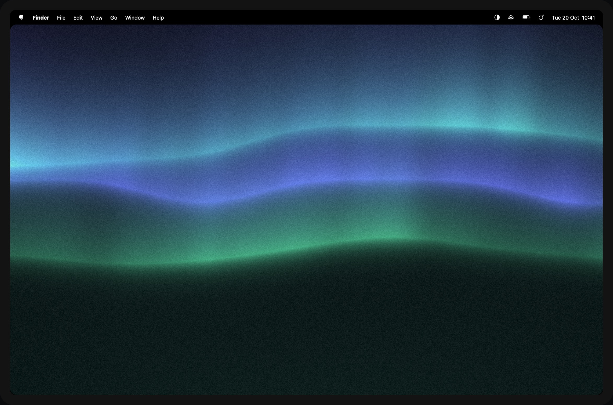

# Undertone

Wallpapers that put themselves back.

Undertone is a small macOS menu bar app that draws the desktop picture itself: soft gradients and shapes in one of
eight tonalities, the light half in light mode and the dark half in dark mode. It started on a company-managed Mac
whose wallpaper kept going back to the default; Undertone notices within seconds and sets its own again.

## Where to go next

| | |
|---|---|
| [Getting started](getting-started/index.md) | Install Undertone and find your way round its menu. |
| [Pictures](pictures/index.md) | The eleven styles, the eight tonalities, and how a new picture is picked. |
| [The desktop](desktop/index.md) | A picture per space, hiding the notch, rounded corners, grain and a title, and how the picture stays set. |
| [Reference](reference/index.md) | Every setting, the `undertone` command, the files Undertone keeps, and updates. |
| [Troubleshooting](troubleshooting.md) | When the picture does not change, or does not stay. |
