# Effects

Effects go over every picture, whatever its style and tonality. Any number can be on at once, each with its own
settings, on the **Effects** page of **Settings…**, which draws each one over the picture showing now.

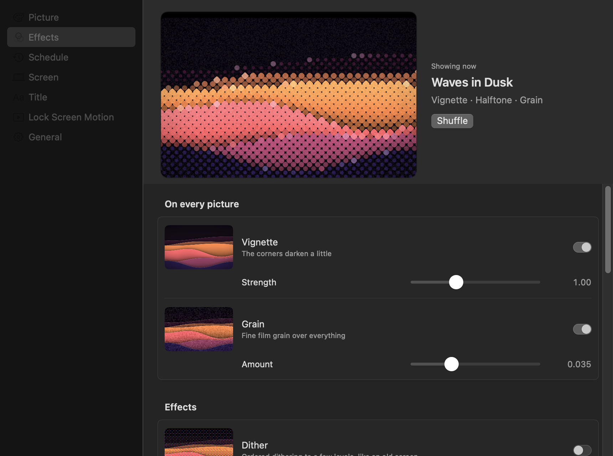

Out of the box two are on: a **vignette** that darkens the corners a little, and a subtle **grain**. The others are
off until you turn them on.

They apply in a fixed order, so no effect undoes another: glass and halftone (which both read the picture somewhere
else), the vignette, bloom, posterize, paper, the light leak, dither, and grain last.

| Effect | Settings |
|---|---|
| Vignette | Strength, 0 to 3 (1 is the usual; dark pictures get more than light ones) |
| Grain | Amount, 0 to 0.12 (0.035 subtle, 0.06 strong) |
| Dither | Levels per colour, 2 to 16; cell size, 1 to 4 points |
| Halftone | Spacing between dots, 4 to 24 points; the grid's angle |
| Glass | Flute width, 12 to 96 points; how much each flute magnifies |
| Bloom | How bright a part must be to glow; strength |
| Light leak | Strength; warmth, from rose to amber |
| Paper | Strength |
| Posterize | Bands of lightness, 3 to 16 |

Each example below is the same aurora picture at the effect's default settings, dark on the left and light on the
right.


## Dither

Ordered (Bayer) dithering to four levels per channel, in cells a point across: the look of an old screen or a risograph. Grain is left off, which would blur the pattern.

| Dark | Light |
|---|---|
| 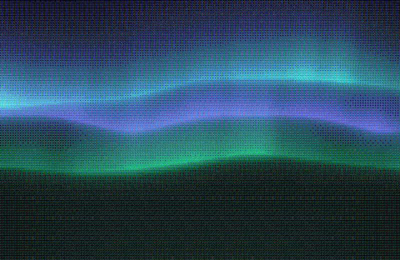 | 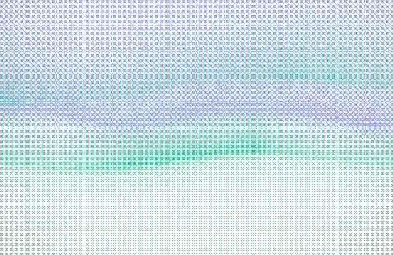 |

## Halftone

A grid of dots at 45°, about 8 points apart, each the colour of the picture under it and bigger the further that colour is from the base: print, up close.

| Dark | Light |
|---|---|
| 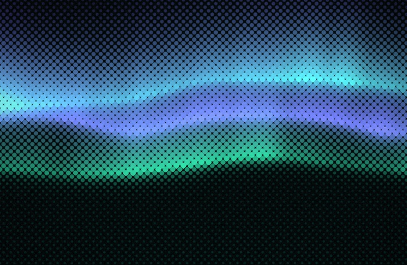 | 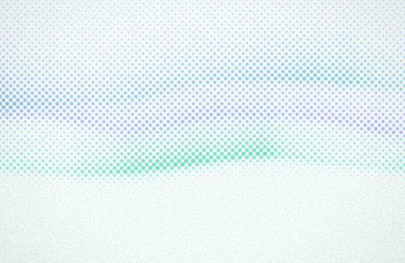 |

## Glass

Reeded glass in front of the picture: vertical flutes about 36 points wide, each showing a magnified slice of what is behind it, lit along one edge.

| Dark | Light |
|---|---|
| 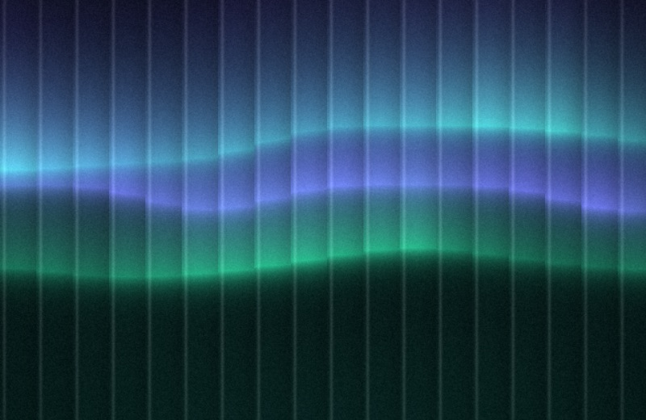 | 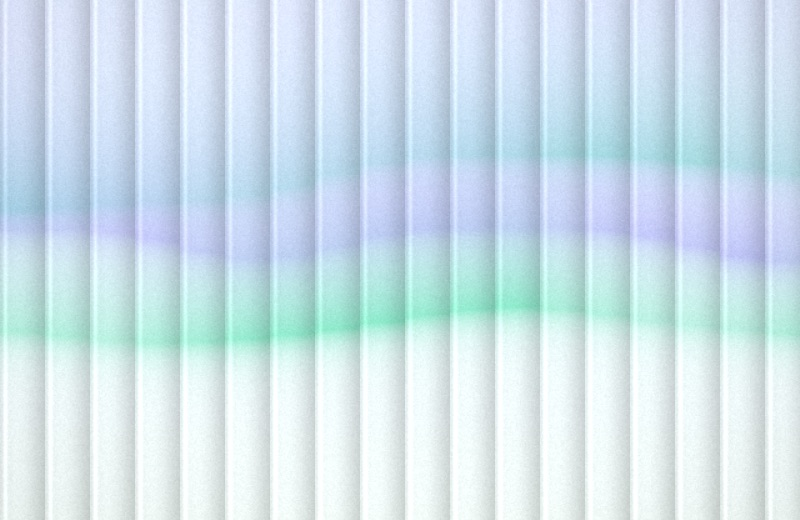 |

## Bloom

On a dark picture the bright parts glow into the dark around them; on a light one, the colours soften and bleed, like a lens with a little haze.

| Dark | Light |
|---|---|
| 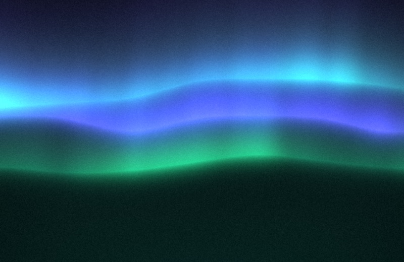 | 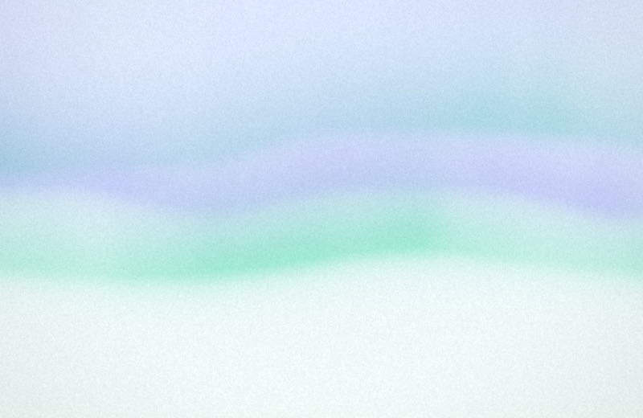 |

## Light leak

A warm film light leak from the left or right edge, at a height that changes with the picture: screened over a dark picture, a warm tint over a light one.

| Dark | Light |
|---|---|
| 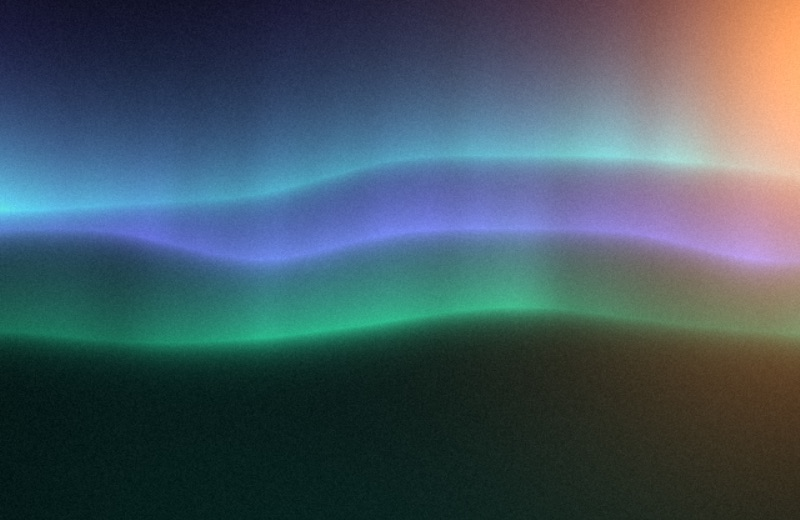 | 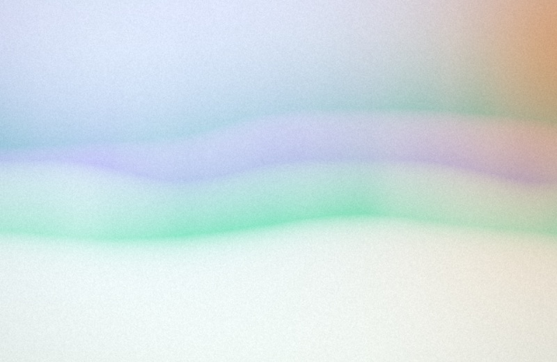 |

## Paper

Mottled paper fibres and the odd speck under the colour, as if the picture were printed on handmade paper.

| Dark | Light |
|---|---|
| 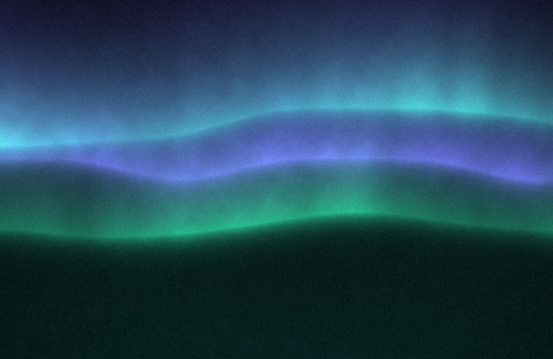 | 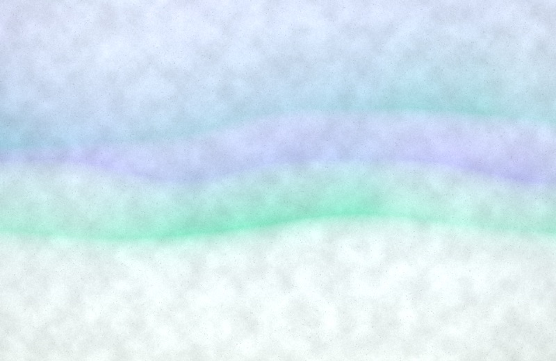 |

## Posterize

Hard bands of lightness instead of smooth gradients, the colour kept: a screen print. Light pictures get narrower bands, so they keep their shapes.

| Dark | Light |
|---|---|
| 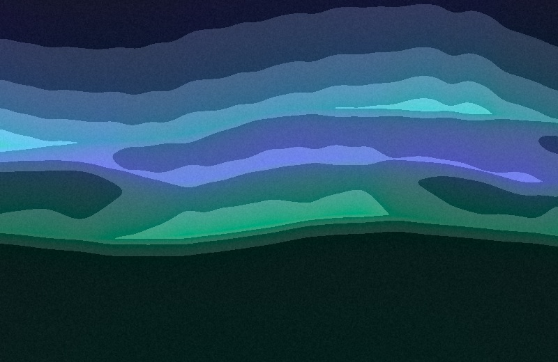 | 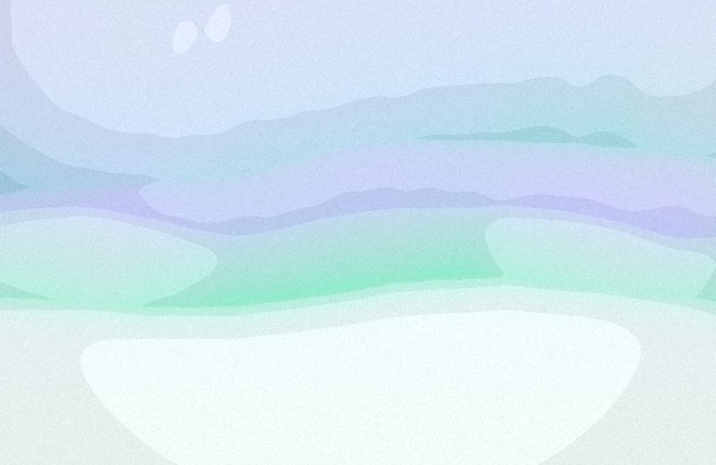 |

## A random effect on each shuffle

**Add a random effect on each shuffle**, on the Effects page, adds one more effect to every new picture: a different
one each time, at its default settings, chosen from those you leave checked and that are not already on. It is off
until you turn it on.

## In the config file

Every effect has its own section in the [config file](../reference/configuration.md); `on` turns it on or off and
keeps its settings:

```toml
[effects]
random = false
random_never = ["dither"]

[effects.grain]
on = true
amount = 0.035

[effects.halftone]
on = true
spacing = 12
angle = 45
```

`undertone render --effect halftone --effect leak` draws effects from the command line (`--effect` can be given more
than once); `undertone effects` lists them.
