# Tonalities

A tonality is five colours for dark mode and five for light: the base the picture sits on, a deep tone, two accents
and a shade. Every space shows the same tonality, even with [a picture per space](../desktop/spaces.md). All of these
are the same *waves* picture; only the tonality changes.

| Tonality | Dark | Light |
|---|---|---|
| **Ember** Amber and violet on near-black; cream and lilac in light mode. | 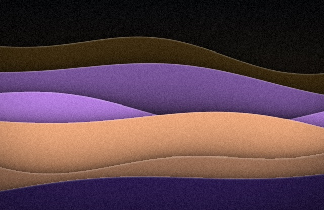 | 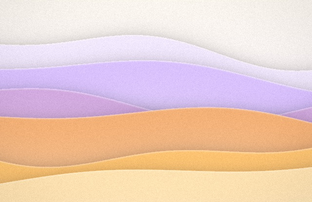 |
| **Tide** Ocean blues and cyan. | 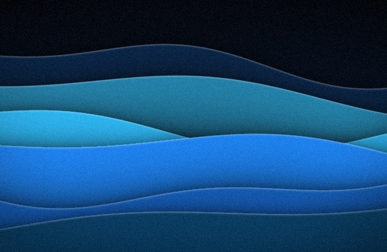 | 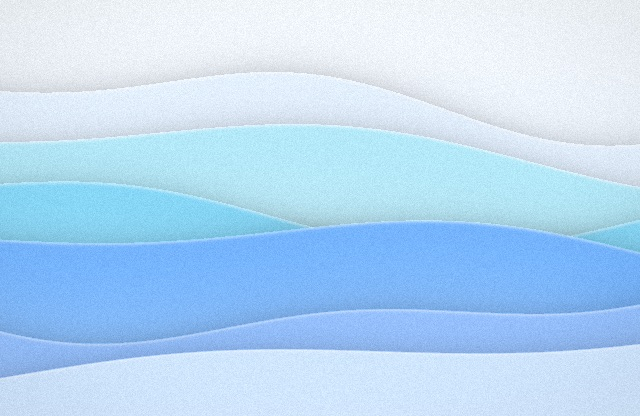 |
| **Aurora** Green and violet light. | 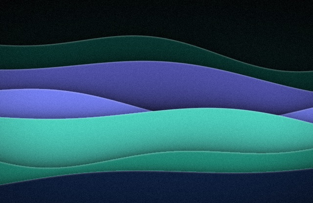 | 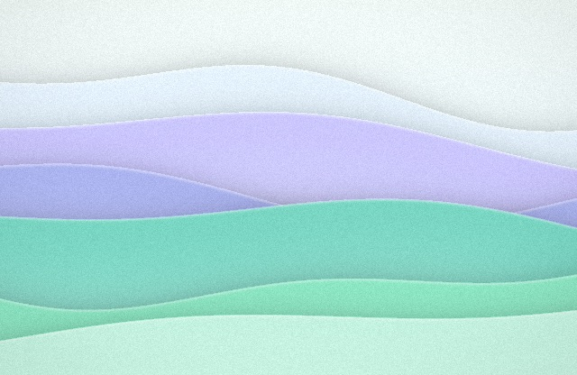 |
| **Dusk** Rose, orange and plum. | 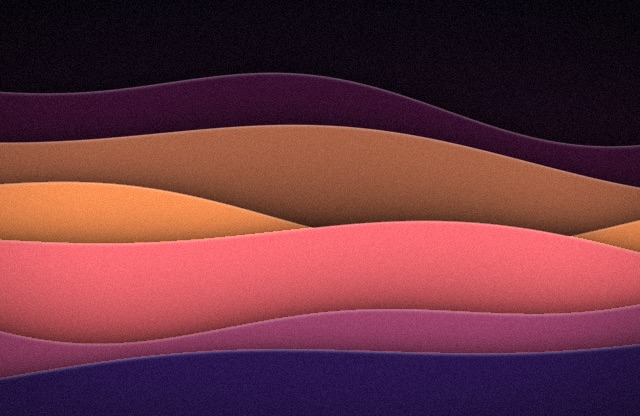 | 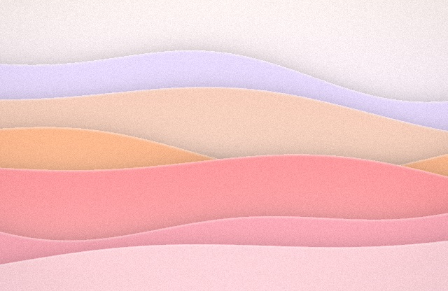 |
| **Moss** Leaf green and gold. | 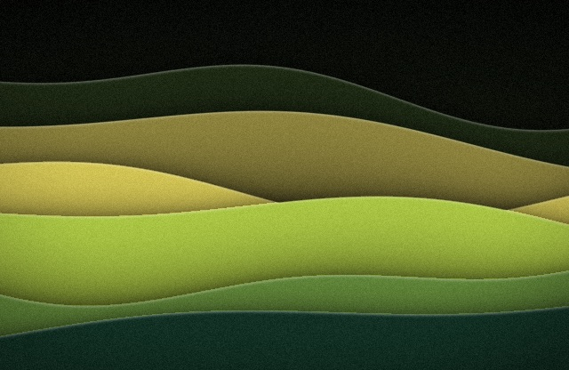 | 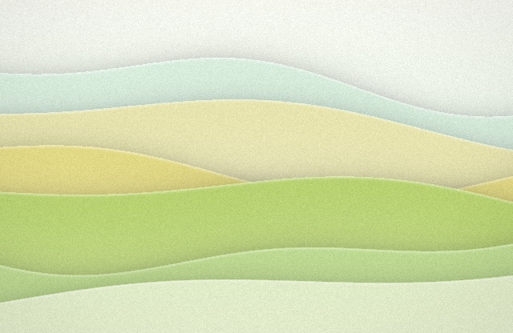 |
| **Glacier** Cold greys and ice blue. | 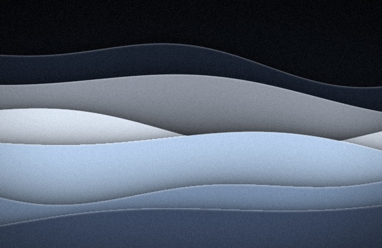 | 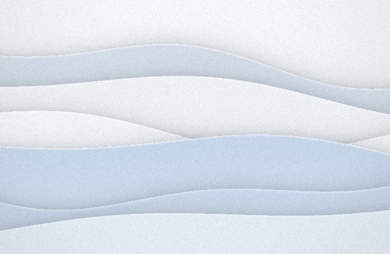 |
| **Citrus** Orange and yellow on warm brown. | 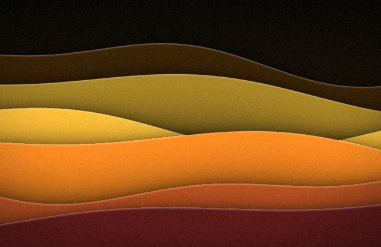 | 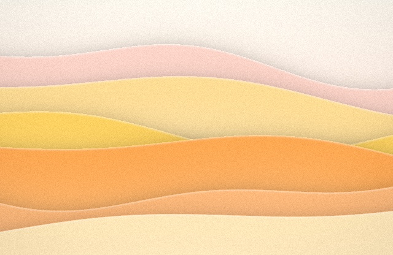 |
| **Mono** Greys only. | 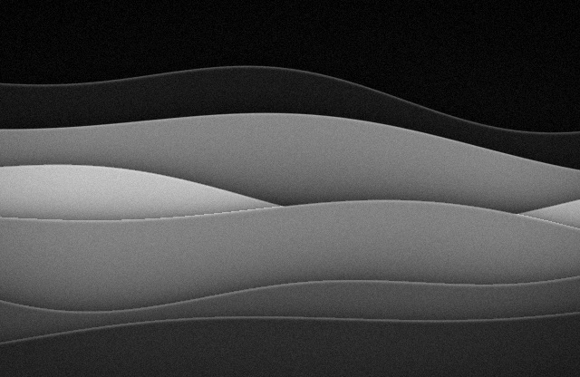 | 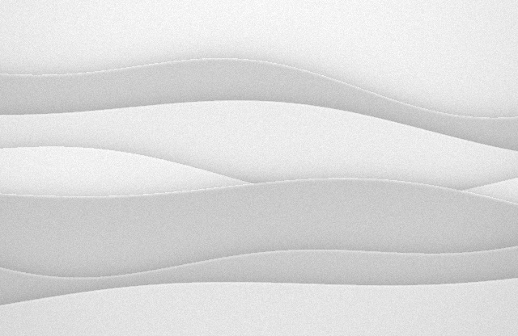 |

Lock one under **Tonality** in the menu, or leave it on **Random**: a random tonality changes on every shuffle,
independently of the style.
